# 🎨 Athar Educational Platform — Comprehensive Frontend UI & Design System Guide
### *Liquid-Glass Architecture · Component Catalog · Field Specifications · Design Tokens*

> **Target Audience:** Frontend Engineers, UI/UX Designers, and AI Agents working on modernizing, redesigning, or polishing the user interface of the **Athar Educational Platform (منصة أثر التعليمية)**.

---

## 📑 Table of Contents
1. [Executive Summary & Visual Philosophy](#1-executive-summary--visual-philosophy)
2. [Global Design System & CSS Token Architecture](#2-global-design-system--css-token-architecture)
3. [Core Application Shell & Global Navigation (`AppLayout.jsx`)](#3-core-application-shell--global-navigation)
4. [Authentication & Onboarding Flow](#4-authentication--onboarding-flow)
5. [Role Dashboards & Navigation Skeletons](#5-role-dashboards--navigation-skeletons)
6. [Feature Modules: Complete Views, Fields & UI States](#6-feature-modules-complete-views-fields--ui-states)
   - [6.1 Course Management (`CoursesModule.jsx`)](#61-course-management)
   - [6.2 Lesson PDF Library (`LessonLibraryModule.jsx`)](#62-lesson-pdf-library)
   - [6.3 Assignments & Dual-Solving Studio (`AssignmentsModule.jsx`, `LiveAnnotationModal.jsx`, `UploadSolvedAssignmentModal.jsx`)](#63-assignments--dual-solving-studio)
   - [6.4 Quizzes & Anti-Cheating Computer Vision Engine (`QuizzesModule.jsx`)](#64-quizzes--anti-cheating-computer-vision-engine)
   - [6.5 Course Scoreboard & Printable Certificates (`ScoreboardModule.jsx`, `certificateGenerator.js`)](#65-course-scoreboard--printable-certificates)
   - [6.6 Progress Tracker & Weekly Reports (`StudentProgressTrackerModule.jsx`, `WeeklyReportsModule.jsx`)](#66-progress-tracker--weekly-reports)
   - [6.7 Course Sessions & Video Classroom (`CourseSessionsModule.jsx`)](#67-course-sessions--video-classroom)
   - [6.8 Real-Time Direct Chat (`DirectChatModule.jsx`)](#68-real-time-direct-chat)
   - [6.9 Smart AI Chatbot Assistant & Walking Mascot (`PlatformChatbotWidget.jsx`, `RobotIntroSplash.jsx`)](#69-smart-ai-chatbot-assistant--walking-mascot)
   - [6.10 Admin Management Modules (`AdminOverview.jsx`, `InstructorsModule.jsx`, `StudentsModule.jsx`)](#610-admin-management-modules)
   - [6.11 Global Modals (`ProfileSettingsModal.jsx`, `UploadProgressModal.jsx`)](#611-global-modals)
7. [UI/UX Improvement Recommendations & Modernization Checklist](#7-uiux-improvement-recommendations--modernization-checklist)

---

## 1. Executive Summary & Visual Philosophy

The **Athar Educational Platform** is designed around the **Aurora Prism Liquid-Glass** aesthetic. It marries futuristic translucency (frosted glass, specular highlights, luminous glow accents) with high-density educational utility.

### Core Visual Principles
- **Atmospheric Multi-Hue Backdrops:** Soft, non-distracting radial gradients anchored by fixed mesh gradients that shift dynamically between Day (crisp ice-blue, lavender, slate) and Night (deep obsidian `#080c1a`, indigo, cyan).
- **Layered Glassmorphism:** Three elevation levels of frosted glass surfaces:
  1. *Level 1 (Subtle surfaces):* `.glass-subtle` for list items, secondary tags, and table rows.
  2. *Level 2 (Cards & Panels):* `.glass-card` and `.glass-panel` with double border highlights (`inset 0 1px 0 rgba(255,255,255,0.85)` in light mode, `inset 0 1px 0 rgba(255,255,255,0.12)` in dark mode).
  3. *Level 3 (Floating Overlays):* Modals, navigation bars, dropdowns, and widgets with `backdrop-blur-2xl` and deep ambient drop shadows.
- **Micro-Interactions & Audible Feedback:** Every interactive element triggers a subtle, high-frequency audio click via Web Audio API (`playClickSound()`) with a master mute toggle in the top bar. Buttons feature lift-on-hover (`hover:-translate-y-0.5`) and tactile press-down states (`active:translate-y-0`).
- **Seamless Bidirectional Internationalization (i18n):** Pixel-perfect support for English (LTR) and Arabic (RTL) via `tailwindcss-rtl`, automatic font switching, and logical alignment utilities (`ms-`, `me-`, `start-`, `end-`).

---

## 2. Global Design System & CSS Token Architecture

### 2.1 Color Palette & Theme Tokens

| Token | Light Theme Value | Dark Theme Value (`.dark`) | Usage |
|---|---|---|---|
| **App Background** | `#f2f4fc` + Multi-hue radial mesh | `#080c1a` / `#050711` + Indigo mesh | Document root & body background |
| **Card Surface** | `rgba(255, 255, 255, 0.75)` | `rgba(15, 23, 42, 0.65)` (`slate-900/65`) | Feature cards, modules, modal content |
| **Form Surface** | `rgba(255, 255, 255, 0.85)` | `rgba(15, 23, 42, 0.80)` (`slate-900/80`) | Input containers, login/register cards |
| **Primary Accent Gradient** | `from-cyan-500 via-violet-600 to-fuchsia-600` | Same (with higher glow opacity) | Call-to-action buttons, active badges |
| **Brand Primary Indigo** | `#4f3df7` to `#703bf7` | `#6366f1` / `#818cf8` | Active sidebar pills, primary links |
| **Emerald Accent** | `#10b981` / `#059669` | `#34d399` / `#059669` | Success states, 100% quiz scores, online dot |
| **Rose Attention** | `#f43f5e` / `#e11d48` | `#fb7185` / `#e11d48` | Unread badges, cheating violations, overdue tags |
| **Border Highlight (Top)** | `rgba(255, 255, 255, 0.90)` | `rgba(255, 255, 255, 0.15)` | Specular edge reflection on glass cards |
| **Border Outline** | `rgba(226, 232, 240, 0.90)` (`slate-200`) | `rgba(255, 255, 255, 0.10)` | Card and input outer borders |
| **Text Primary** | `#0f172a` (`slate-900`) | `#f8fafc` (`slate-100`) | Headings, main metrics, primary labels |
| **Text Secondary** | `#64748b` (`slate-500`) | `#94a3b8` (`slate-400`) | Descriptions, timestamps, metadata |

### 2.2 Typography Scale
- **Primary Font Families:**
  - Latin (English): `"Plus Jakarta Sans"`, `system-ui`, `sans-serif`
  - Arabic: `"Cairo"`, `"Segoe UI"`, `Tahoma`, `sans-serif`
- **Typographic Hierarchy:**
  - `Hero Display`: `text-3xl sm:text-4xl lg:text-5xl font-black tracking-tight`
  - `Section Header (H1/H2)`: `text-xl sm:text-2xl font-black text-slate-900 dark:text-white`
  - `Card Header (H3)`: `text-base sm:text-lg font-extrabold`
  - `Module Section Subtitle`: `text-xs sm:text-sm font-bold text-slate-500 dark:text-slate-400`
  - `Body Standard`: `text-xs sm:text-[13px] leading-relaxed`
  - `Form Labels`: `text-xs font-bold uppercase tracking-wider text-slate-700 dark:text-slate-300`
  - `Micro Tag / Badge`: `text-[10px] sm:text-[11px] font-black uppercase tracking-wider`

### 2.3 Ready-to-Use Tailwind Glass Component Classes

```css
/* Glass Panel */
.glass-panel {
  @apply bg-white/70 dark:bg-slate-900/65 backdrop-blur-2xl border border-white/80 dark:border-white/15 
         shadow-[0_14px_42px_rgba(79,70,229,0.10),inset_0_1px_0_rgba(255,255,255,0.85)] 
         dark:shadow-[0_16px_44px_rgba(0,0,0,0.55),inset_0_1px_0_rgba(255,255,255,0.12)];
}

/* Interactive Card */
.glass-card {
  @apply relative overflow-hidden bg-white/75 dark:bg-slate-900/65 backdrop-blur-2xl 
         border border-white/85 dark:border-white/15 rounded-[24px] 
         shadow-[0_10px_32px_rgba(37,99,235,0.09),inset_0_1px_0_rgba(255,255,255,0.85)] 
         dark:shadow-[0_12px_36px_rgba(0,0,0,0.48),inset_0_1px_0_rgba(255,255,255,0.10)] 
         transition-all duration-300 hover:-translate-y-1 
         hover:shadow-[0_20px_48px_rgba(124,58,237,0.18)] 
         dark:hover:shadow-[0_20px_48px_rgba(56,189,248,0.20)] 
         hover:border-cyan-400/75 dark:hover:border-violet-400/50;
}

/* Glass Input */
.glass-input {
  @apply bg-white/80 dark:bg-slate-800/70 backdrop-blur-md border border-slate-200/90 dark:border-white/10 
         rounded-2xl text-slate-900 dark:text-slate-100 placeholder:text-slate-400 dark:placeholder:text-slate-500 
         shadow-sm focus:bg-white dark:focus:bg-slate-800/95 focus:outline-none focus:ring-4 
         focus:ring-indigo-500/15 focus:border-indigo-500/80 transition-all duration-200;
}

/* Primary Glass Button */
.glass-btn-primary {
  @apply bg-gradient-to-r from-cyan-500 via-violet-600 to-fuchsia-600 
         hover:from-cyan-400 hover:via-violet-500 hover:to-fuchsia-500 text-white font-bold 
         rounded-2xl shadow-[0_10px_24px_rgba(124,58,237,0.32)] 
         hover:shadow-[0_14px_32px_rgba(217,70,239,0.42)] hover:-translate-y-0.5 
         active:translate-y-0 transition-all duration-200;
}
```

---

## 3. Core Application Shell & Global Navigation

All authenticated routes are rendered within **`client/src/components/layout/AppLayout.jsx`**.

```
┌────────────────────────────────────────────────────────────────────────────────────────────────────┐
│ TOP HEADER (Pill Shape: Logo · Role Badge · Breadcrumb · Sound · Theme · Language · Notifications)  │
├───────────────────────────────┬────────────────────────────────────────────────────────────────────┤
│ SIDEBAR DOCK (Fixed Desktop)  │ MAIN SCROLLABLE CONTENT VIEWPORT                                   │
│ • Logo & Platform Tagline     │                                                                    │
│ • Role-Aware Navigation Links │ [ Active Feature Module / Route Rendered Here ]                    │
│   (Active Gradient Pill)      │                                                                    │
│   (Unread Direct Chat Badge)  │                                                                    │
│ • User Profile Settings Mini  │                                                                    │
│ • Logout Action Button        │                                                                    │
├───────────────────────────────┴────────────────────────────────────────────────────────────────────┤
│ FLOATING PLATFORM AI CHATBOT WIDGET (Bottom Corner: Walking Mascot Launcher + Glass Chat Pane)     │
└────────────────────────────────────────────────────────────────────────────────────────────────────┘
```

### 3.1 Sidebar Dock Specifications
- **Desktop Geometry:** Fixed width `w-[280px]` (or `w-[290px]` on xl), height `h-full`, border radius `rounded-[28px]`, outer margins `lg:p-3 lg:gap-3.5`.
- **Mobile Geometry:** Off-canvas drawer `w-[86vw] max-w-[310px]`, sliding in with `translate-x-0` and backed by `bg-slate-950/60 backdrop-blur-sm`.
- **Navigation Items (`navItems.map`):**
  - **Active State:** Solid gradient `bg-gradient-to-r from-[#4f3df7] to-[#703bf7] text-white font-extrabold shadow-md shadow-indigo-600/30` with an accent vertical bar at `-start-2`.
  - **Inactive State:** `text-slate-700 dark:text-slate-300 hover:text-indigo-600 dark:hover:text-white hover:bg-indigo-50/70 dark:hover:bg-white/5 font-bold`.
  - **Direct Chat Attention Badge:** Pulsing ping circle (`animate-ping bg-rose-400`) and counter pill (`bg-gradient-to-r from-rose-500 to-pink-500 text-white min-w-[20px] h-5 text-[10.5px] font-black rounded-full`).
- **Bottom User Profile Tile:**
  - Displays avatar initials in gradient squircle `bg-gradient-to-tr from-teal-500 to-emerald-500`, user full name, role badge (`student`, `instructor`, `admin`), settings gear button (opens `ProfileSettingsModal`), and full-width red logout button (`bg-rose-50 hover:bg-rose-100 text-rose-600`).

### 3.2 Top Header Floating Pill Bar
- **Position & Styling:** `sticky top-1 sm:top-2 lg:top-0 z-20`, pill shape `rounded-2xl sm:rounded-full`, backdrop blur `bg-white/95 dark:bg-slate-900/95 backdrop-blur-2xl`.
- **Components from Start to End:**
  1. *Mobile Hamburger Button (`lg:hidden`):* Contains `<Menu />` icon plus a floating red notification dot if unread direct chat messages exist.
  2. *Brand Identity Pill:* Transparent platform logo (`Logo.png`) + dynamic localized role tag (`roles.student`, `roles.instructor`, `roles.admin`).
  3. *Breadcrumb Trail (`hidden md:flex`):* `/ Current Section Name`.
  4. *Sound FX Toggle Button:* `<Volume2 />` or `<VolumeX />` icon toggle, controls platform-wide Web Audio feedback.
  5. *Dark / Light Mode Toggle:* `<Sun />` or `<Moon />` icon toggle with smooth color transitions.
  6. *Bilingual Language Switcher (`LanguageDropdown.jsx`):* Dropdown selecting English (LTR) or Arabic (RTL).
  7. *Notification Bell & Popover Box:* Luminous badge with unread count. Clicking opens a glass drop-panel showing notifications list, "Mark All as Read", "Clear All", and clickable notification links.

---

## 4. Authentication & Onboarding Flow

### 4.1 Login Page (`client/src/features/auth/LoginPage.jsx`)
- **Layout:** Split-screen layout (`h-screen overflow-hidden`) with a top floating pill header and a dual-card body.
- **Left/Start Branding Card (Desktop):** Gradient showcase card featuring platform title, description, illustration (`hero.png`), and glowing feature bullet tags (AI Quiz Engine, Multi-page PDF Annotation, Anti-Cheat Camera Proctoring).
- **Right/End Form Card:** Frosted glass card (`.glass-form-card`) containing:
  - *Identifier Input:* Username or Email address with `<Mail />` / `<User />` icon prefix.
  - *Password Input:* Password field with visibility toggle (`<Eye />` / `<EyeOff />`).
  - *Remember Me Checkbox:* Custom checkbox saving credentials to `localStorage`.
  - *Primary Action Button:* Gradient button (`glass-btn-primary`) with loading spinner.
  - *Registration Link:* Navigation to `/register`.
- **Special Error States:** Specific error popups for `ACCOUNT_DISABLED`, `PENDING_INSTRUCTOR_APPROVAL`, `REQUEST_REJECTED`, and `INVALID_CREDENTIALS`.

### 4.2 Register Page (`client/src/features/auth/RegisterPage.jsx`)
- **Role Selection Segmented Switcher:** Two large selectable cards or tabs choosing **Student** or **Instructor**.
- **Student-Specific Registration Fields:**
  - *Instructor Multi-Select:* Grid of approved instructor cards with avatar, specialization, and selectable checkmark. Student must choose at least one instructor to submit.
- **Instructor-Specific Registration Fields:**
  - *Specialization Input (English & Arabic):* Field capturing academic or technical domain (e.g., Computer Science, Artificial Intelligence).
  - *Bio / Description Field:* Optional biographical summary.
- **Universal Fields:** Full Name, Username (unique handle), Email address, Password, Confirm Password with dynamic live password strength meter (Weak / Medium / Strong).

### 4.3 Website Robot Intro Splash Screen (`client/src/components/common/RobotIntroSplash.jsx`)
- **Experience:** On initial entry per browser session, an animated SVG robot mascot enters from the left and walks across the screen.
- **Dynamic Title Reveal:** Behind the walking robot, the futuristic neon text **"ATHAR AI"** (`منصة أثر التعليمية`) writes out across the center.
- **Controls:** Includes a "Skip Intro" pill button in the top corner and auto-dismisses upon completion.

---

## 5. Role Dashboards & Navigation Skeletons

```mermaid
graph TD
    Root["/ (Root Redirect)"] --> AuthCheck{"Authenticated?"}
    AuthCheck -->|No| Login["/login & /register"]
    AuthCheck -->|Yes - Admin| AdminRoute["/admin/*"]
    AuthCheck -->|Yes - Instructor| InstRoute["/instructor/*"]
    AuthCheck -->|Yes - Student| StuRoute["/student/*"]

    subgraph Admin_Modules [Admin Navigation]
        AdminRoute --> A1["/admin (Overview)"]
        AdminRoute --> A2["/admin/instructors"]
        AdminRoute --> A3["/admin/sessions"]
        AdminRoute --> A4["/admin/scoreboard"]
        AdminRoute --> A5["/admin/grades"]
    end

    subgraph Instructor_Modules [Instructor Navigation]
        InstRoute --> I1["/instructor (Analytics Dashboard)"]
        InstRoute --> I2["/instructor/students"]
        InstRoute --> I3["/instructor/courses"]
        InstRoute --> I4["/instructor/lesson-pdfs"]
        InstRoute --> I5["/instructor/sessions"]
        InstRoute --> I6["/instructor/chat (Direct Chat)"]
        InstRoute --> I7["/instructor/assignments"]
        InstRoute --> I8["/instructor/quizzes"]
        InstRoute --> I9["/instructor/scoreboard"]
        InstRoute --> I10["/instructor/progress-tracker"]
        InstRoute --> I11["/instructor/grades"]
    end

    subgraph Student_Modules [Student Navigation]
        StuRoute --> S0["/student (Instructor Picker)"]
        S0 -->|Requires Active Instructor| S1["/student/courses"]
        S0 --> S2["/student/lesson-pdfs"]
        S0 --> S3["/student/sessions"]
        S0 --> S4["/student/chat (Teacher Chat)"]
        S0 --> S5["/student/assignments"]
        S0 --> S6["/student/quizzes"]
        S0 --> S7["/student/scoreboard"]
        S0 --> S8["/student/grades"]
        S0 --> S9["/student/weekly-reports"]
    end
```



---

## 6. Feature Modules: Complete Views, Fields & UI States

### 6.1 Course Management (`CoursesModule.jsx`)
- **Header Controls:** Search bar (`glass-input`), Category/Instructor filter dropdown, "Create New Course" button (`instructor` / `admin`).
- **Course Card Anatomy:**
  - *Media Header:* Course banner image with glass tag showing category and language indicator.
  - *Title & Meta:* Localized title (`title.en` / `title.ar`), instructor name, enrolled students counter with `<Users />` icon, lesson count with `<BookOpen />` icon.
  - *Student Progress Bar:* Horizontal percentage fill bar showing completed lessons/quizzes.
  - *Action Bar:* "Enter Course" / "Enroll" button, "Manage Lessons" drawer button, "Edit Course" button, "Delete Course" icon.
- **Create / Edit Course Modal:**
  - `Course Title (English)` & `Course Title (Arabic)` (required text inputs).
  - `Category / Domain` (select dropdown: AI, Programming, Networks, Electronics, etc.).
  - `Description (English & Arabic)` (multi-line textareas).
  - `Cover Image URL / File Picker`.
  - `Enrolled Students Multi-Picker` (checkbox list of registered students).

---

### 6.2 Lesson PDF Library (`LessonLibraryModule.jsx`)
- **Header Controls:** Filter by course selector, search input, "Upload PDF Lesson" button.
- **Lesson PDF Card Anatomy:**
  - PDF document icon badge with file size and upload date.
  - Lesson title and parent course badge.
  - **Text Extraction Status Badge:** Green checkmark badge (`Text Extracted for AI`) or Amber badge (`Processing Text`).
  - **Action Buttons:**
    - *"Open in Annotation Notebook":* Launches `LiveAnnotationModal` in student study mode.
    - *"Download Original PDF":* Direct download link.
    - *"Delete Lesson":* Trash icon with confirmation dialog.
- **Upload Lesson Modal:**
  - Course selection dropdown.
  - Lesson Title (EN & AR).
  - File Dropzone accepting `.pdf` documents with upload progress animation.
  - Automatic background text extraction trigger.

---

### 6.3 Assignments & Dual-Solving Studio

The assignments feature offers flexible solving modes for students (download to solve offline, live digital annotation, and solved file uploads) accompanied by automated AI grading.

```
┌────────────────────────────────────────────────────────────────────────────────────────┐
│ STUDENT ASSIGNMENT CARD                                                                │
│ Title: Machine Learning Worksheet 3 · Max: 20 pts · Due: Oct 24, 18:00                  │
├────────────────────────────────────────────────────────────────────────────────────────┤
│ [ 📥 Download to Solve (Watermarked) ] [ 🖊️ Live Annotation ] [ ⚡ Upload Solved File ] │
└────────────────────────────────────────────────────────────────────────────────────────┘
```

#### 6.3.1 Assignments Management (`AssignmentsModule.jsx`)
- **Tab Filter:** All Assignments · Active / Pending · Submitted · Graded.
- **Assignment Card Elements:** Course badge, assignment title, due date & countdown badge (`min={today}` future date lock), max points badge (`Max Marks`), status badge ("Not Submitted", "Submitted - Pending Grade", "Graded X/Y", "Overdue").
- **Watermarked PDF Downloader (`assignmentPdfDownloader.js`):**
  - Instant one-click action generating an official watermarked PDF worksheet.
  - Automatically imprints high-resolution diagonal platform watermark text: `"ATHAR EDUCATIONAL PLATFORM • منصة أثر التعليمية"`, secondary security subtitles, header banner, student name, and footer metadata.
  - Students can solve offline on tablets (GoodNotes, Notability, Acrobat), on PCs, or print on physical paper.
- **Assignment Creation Modal Fields:**
  - `Course ID` (dropdown).
  - `Assignment Title` (text).
  - `Worksheet PDF Attachment` (file dropzone).
  - `Maximum Marks` (number input, e.g., `10`, `20`, `100`).
  - `Due Date` (`min={today}` date picker) & `Due Time` (time picker).
  - `Submission Instructions` (textarea).

#### 6.3.2 Live Annotation Canvas Studio (`LiveAnnotationModal.jsx`)
- **Canvas Viewport:** Fullscreen high-resolution PDF rendering via Mozilla PDF.js.
- **Top Toolbar:**
  - Page Navigation: `<Prev />`, `<Next />`, `Page X of Y`, direct page jump input.
  - Zoom Controls: Zoom In (`+`), Zoom Out (`-`), Fit-to-Width.
  - History Controls: `<Undo />`, `<Redo />`, `<Clear Page />`.
- **Drawing Tool Palette:**
  - *Pen Tool:* Smooth bezier interpolation, color picker presets (Black, Blue, Red, Green, Purple), stroke slider (1px to 20px).
  - *Highlighter Tool:* Semi-transparent stroke (Yellow, Neon Green, Cyan, Pink).
  - *Eraser Tool:* Click-and-drag path eraser.
  - *Text Box Tool:* Font size picker, color picker, click-to-place editable text annotation.
  - *Stamp Tool:* Correct checkmark stamp, incorrect cross stamp, star stamp.
- **Bottom Bar:** Student submission notes textarea, points display, "Submit Assignment" button.

#### 6.3.3 Solved Assignment Upload Modal (`UploadSolvedAssignmentModal.jsx`)
- **Download Helper Banner:** Step 1 banner allowing the student to download the watermarked assignment PDF directly if they have not yet obtained it.
- **File Dropzone:** Accepts pre-solved PDF documents or clear photos/scans (JPG, PNG).
- **Multi-Page Preview:** Instant canvas rendering and multi-page slider allowing students to verify their pages before submitting.
- **Automated AI Grading Engine (`/api/assignment/grade`):**
  - Evaluates handwritten or typed submissions via multimodal Gemini 2.5.
  - **Zero-Point Blank Detection:** Blank or unattempted worksheets automatically receive 0 points with a diagnostic "What Went Wrong" report.
  - **Proportional Scoring:** Accurately calculates points out of `maxMarks`.
  - **Student Diagnostic Feedback:** Detailed bullet points for "What Went Right" and "What Went Wrong".
  - **Teacher Model Answer Key:** Generates model answers, step-by-step solutions, and specific grading explanations.

---

### 6.4 Quizzes & Anti-Cheating Computer Vision Engine (`QuizzesModule.jsx`)

```
┌────────────────────────────────────────────────────────────────────────┐
│ ACTIVE QUIZ PLAYER VIEW                                                │
│ Question 3 of 10  │  ⏱️ Timer: 08:45  │  [ Submit Assessment ]         │
├────────────────────────────────────────────────────────────────────────┤
│                 [ 📹 Floating PiP Live Camera (160x110) ]              │
│                                                                        │
│ Question Card:                                                         │
│ Which activation function is zero-centered and outputs between -1 & 1? │
│   ○ A) Sigmoid                                                         │
│   ● B) Tanh                                                            │
│   ○ C) ReLU                                                            │
│   ○ D) Leaky ReLU                                                      │
├────────────────────────────────────────────────────────────────────────┤
│ Question Navigator: [1] [2] [●3] [4] [5] [6] [7] [8] [9] [10]          │
└────────────────────────────────────────────────────────────────────────┘
```

#### 6.4.1 Pre-Quiz Webcam Verification Modal
- Student cannot access questions without granting camera permissions.
- Displays live mirrored camera preview and confirms anti-cheating monitoring rules.

#### 6.4.2 Active Quiz Player & Floating PiP
- **Top Bar:** Progress bar, real-time countdown timer (turns amber at 2 min, pulsing red at 1 min), "Submit Quiz" action.
- **Floating Top-Center PiP Window:** Persistent 160×110px mirrored live video feed anchored at `top: 14px; left: 50%; transform: translateX(-50%)` with glowing red `LIVE` badge. Kept completely clear of questions and answer options.
- **Dual Question Typologies:**
  - *Multiple Choice (MCQ):* Single-select radio or multi-select checkbox choices with option badges.
  - *Theoretical / Conceptual Questions:* Dedicated rich textareas allowing students to write out long-form explanations with live word counts, graded automatically by AI against model criteria.
- **Question Navigator Grid:** Numbered buttons (1..N) indicating answered (green), current (indigo), and unanswered (slate).

#### 6.4.3 Quiz Builder, Difficulty & Auto-Estimated Timer
- **Difficulty Selection:** `Easy`, `Medium`, `Hard`.
- **Auto-Calculated Estimated Time:** Real-time formula estimating completion time dynamically from difficulty and question mix (MCQ vs. Theoretical), applied with one click or auto-assigned during AI quiz generation.
- **Theoretical Question Authoring:** Teachers can specify the question prompt, expected model answer (`الإجابة النموذجية`), and key rubric criteria keywords.

#### 6.4.4 Anti-Cheating & Computer Vision Security Suite
1. **On-Device Real-Time Mobile Phone Detection:** Powered by TensorFlow.js (`@tensorflow/tfjs`) and COCO-SSD (`@tensorflow-models/coco-ssd`). Detecting a `cell phone` triggers **immediate first-offense termination** without grace warnings.
2. **Instant Camera Covering & Blackout Detection:** Canvas luminance and texture variance analysis (`avgBrightness < 35`, `stdDev < 15`). If the student covers the camera lens or the screen goes black for ~0.9–1.0 second, the quiz terminates immediately.
3. **Camera Disconnect Protection:** Disconnecting the camera triggers 1 warning; a second disconnect causes immediate disqualification.
4. **Anti-Screenshot & Privacy Shield (Strict 2-Strike System):** Blocks right-click/copy/cut, intercepts `PrintScreen`, snipping shortcuts (`Win+Shift+S`, `Cmd+Shift+3/4/5`), `Ctrl+P`, `F12`, tab switching, and window blur to hide questions behind a blackout privacy shield and wipe clipboard data.
5. **Fullscreen Cheating Violation Overlay (`z-index: 100010`):** Unmissable alert dialog communicating the exact reason for termination and permanently locking re-entry until approved by the instructor.

#### 6.4.5 Quiz Results & AI Theoretical Grading
- Displays score percentage, earned integer points, and per-question correctness indicator.
- **AI Theoretical Correction:** Grades student written responses (`Correct / 1 pt`, `Partially Correct / 0.5 pt`, `Incorrect / 0 pts`), displaying the student's answer, reference model answer, and detailed AI feedback explaining what was accurate and what was missing.
- Interactive AI explanation card for each incorrect answer explaining why the chosen option was wrong and why the correct answer is right.
- "Request Retake" button for disqualified or low-scoring students.

---

### 6.5 Course Scoreboard & Printable Certificates (`ScoreboardModule.jsx`)

#### 6.5.1 Liquid-Glass 3D Podium
- Course selection dropdown.
- **Podium Visual Layout:**
  - **1st Place (Center, Tallest Step):** Glowing Gold aura, crown icon, student avatar, full name, total points badge.
  - **2nd Place (Left Step):** Silver-Indigo styling.
  - **3rd Place (Right Step):** Bronze-Teal styling.
- **4th & 5th Place Runner-Up Cards:** Horizontal cards below the podium showing rank, avatar, name, and total points.
- **Points Formula:** `Total Points = Quiz Points + Assignment Points`.

#### 6.5.2 Printable Branded PDF Certificates (`certificateGenerator.js`)
- Instructors and Admins can generate downloadable, high-resolution printable certificates:
  - **Gold Certificate:** 1st place champion.
  - **Silver-Indigo Certificate:** 2nd place runner-up.
  - **Bronze-Teal Certificate:** 3rd place runner-up.
- **Certificate Elements:** Official platform logo, decorative guilloche borders, student name, course title, total points breakdown, date of issue, and cursive instructor signature.

---

### 6.6 Progress Tracker & Weekly Reports (`StudentProgressTrackerModule.jsx`, `WeeklyReportsModule.jsx`)
- **Filter Controls:** Student selector (instructor mode), `From Date` and `To Date` pickers (with strict validation ensuring `To Date` cannot precede `From Date`).
- **KPI Summary Grid:**
  - Total Points Earned.
  - Quizzes Completed & Average Score %.
  - Assignments Submitted & Pending Grades.
  - Retake Counts & Violation Logs.
- **Visual Analytics:** Interactive Recharts points progression bar chart and score distribution.
- **Chronological Activity Log:** Tabular listing of every quiz and assignment event with timestamps, scores, and status tags.
- **Export Actions:** Download multi-page branded PDF report (with logo, KPIs, chart, and instructor signature) and CSV export.
- **Automated 7-Day Weekly Reports:** Background scheduler dispatches performance summaries every 7 calendar days to students.

---

### 6.7 Course Sessions & Video Classroom (`CourseSessionsModule.jsx`)
- **Card Elements:** Session title, course tag, scheduled date and time, duration, instructor name.
- **Live Meeting Support:** Join Meeting button launching live video room (Zoom, Google Meet, Teams, or WebRTC).
- **Recorded Video Embed:** Direct inline video player for recorded lectures (YouTube, Vimeo, or direct MP4 stream).
- **Attendance Tracker:** Instructors can mark and export student attendance.

---

### 6.8 Real-Time Direct Chat (`DirectChatModule.jsx`)

```
┌──────────────────────────────────────┬────────────────────────────────────────────────────────┐
│ CONTACTS SIDEBAR                     │ ACTIVE CHAT THREAD                                     │
│ 🔍 Search contacts...                │ 👤 Dr. Ahmed (Instructor) · 🟢 Online                  │
├──────────────────────────────────────┼────────────────────────────────────────────────────────┤
│ [👤 Sara Ali]                        │ [Sara - 10:14 AM]                                      │
│ How do I solve Q3? · 10:14 AM  🔴 2  │ Could you please explain question 3 on the worksheet?  │
│                                      │                                                        │
│ [👤 Mohamed Maher]                   │ [You - 10:15 AM] ✓✓                                    │
│ Assignment submitted · Yesterday     │ Sure! Check the formula on slide 14 of Lesson 2.       │
│                                      ├────────────────────────────────────────────────────────┤
│                                      │ 📎 [ Attach ]  [ Type your message... ]  [ Send ✈️ ]    │
└──────────────────────────────────────┴────────────────────────────────────────────────────────┘
```

- **Split-Pane Architecture:**
  - **Left / Start Contact Sidebar:** Search bar, contact list showing avatars, online indicator dots, role badges, last message preview, timestamps, and real-time unread badges.
  - **Right / End Conversation Pane:** Active contact header with status, message bubble thread with date dividers, incoming bubbles (`.glass-subtle`), outgoing bubbles (gradient `from-[#4f3df7] to-[#703bf7]`), double checkmark delivery ticks (`✓✓`), and image/PDF attachment previews.
- **Real-Time Sidebar Attention Integration:** Unread messages increment `unreadByInstructor` or `unreadByStudent` in Firebase RTDB, triggering the sidebar attention badge in `AppLayout.jsx`.
- **Instant Clear on Read:** Actively viewing or chatting in a conversation immediately clears the unread count.

---

### 6.9 Smart AI Chatbot Assistant & Walking Mascot

#### 6.9.1 Animated Mascot Launcher
- SVG walking robot mascot with localized patrol animations (`robot-patrol` for LTR, `robot-patrol-rtl` for RTL).
- Positioned ergonomically in the bottom corner of the viewport.
- Clicking the mascot launches the liquid-glass chatbot window.

#### 6.9.2 Chatbot Interface (`PlatformChatbotWidget.jsx`)
- **Header:** Athar AI branding, status indicator, clear chat button, language translate toggle, minimize button.
- **Starter Quick Action Chips:**
  - *"Summarize a lesson"* (`تلخيص درس`): Opens the lesson browser.
  - *"My points & marks"* (`نقاطي ودرجاتي`): Retrieves instant student points breakdown.
  - *"Make a quiz on a lesson"* (Instructor/Admin): Prompts instant quiz generation.
- **Lesson Summarization Browser:** Clicking "Summarize a lesson" lists **all available course lessons and PDF materials** with interactive chips. Clicking any chip produces an instant, structured educational summary of that lesson.
- **High-Speed Multimodal Attachments & Voice Notes:**
  - Students can attach photos of handwritten problems, PDF documents, or recorded voice notes.
  - **Live Voice Note Recording:** Direct microphone recording dock with pulsating live timer (`00:05`), audio stream waveform indicator, and cancel/stop controls.
  - **Voice Audio Understanding:** Powered by Gemini 2.5 multimodal audio processing for Arabic and English spoken questions.
  - **Spoken Voice Answers (TTS):** Every bot message includes a read-aloud voice action button (`<Volume2 />` / `<VolumeX />`) using browser speech synthesis with automatic Arabic/English language and voice selection.

---

### 6.10 Admin Management Modules

#### 6.10.1 Admin Overview (`AdminOverview.jsx`)
- System KPI Cards: Total Active Users, Registered Instructors, Enrolled Students, Published Courses, Completed Quizzes, Active Live Sessions.
- System Activity Log: Real-time chronological audit trail of platform events.
- Platform-Wide Notification Broadcast Modal.

#### 6.10.2 Instructors Directory (`InstructorsModule.jsx`)
- Table / Grid view of all instructor profiles.
- Actions: "Add Instructor" modal, toggle account active/disabled, reset password, delete account with confirmation dialog.
- Fields: Full Name (EN & AR), Email, Specialization, Assigned Courses, Join Date, Account Status.

#### 6.10.3 Students Directory (`StudentsModule.jsx`)
- Filterable student directory by name, email, instructor assignment, or course enrollment.
- Detail view showing student points, quiz submission history, and retake logs.

---

### 6.11 IQ Puzzles & Cognitive Brain Hub (`IQPuzzlesModule.jsx`)
- **Gamified Level Progression:** 10 uniquely themed levels with ascending cognitive difficulty (Easy, Medium, Hard, Expert, Grandmaster, Mastermind).
- **Diverse Puzzle Types:**
  1. *Level 1 (Numerical Reasoning):* The Doubling Ladder number sequence induction.
  2. *Level 2 (Abstract Spatial IQ):* Raven's Progressive Rotation Matrix (rotational angles and dot counts).
  3. *Level 3 (Cryptographic Logic):* The Cryptographic Sum substitution cipher.
  4. *Level 4 (Deductive Logic):* The Three Mystery Vaults truth-teller and liar elimination.
  5. *Level 5 (Algebraic Balance):* Geometry Balance Scale simultaneous weight equations.
  6. *Level 6 (Boolean Logic):* Boolean Network Router multi-stage signal propagation.
  7. *Level 7 (Mechanical Kinematics):* Chronos Gear Train transmission ratio & rotational directions.
  8. *Level 8 (Strategic Optimization):* Midnight Server Bridge river crossing bottleneck minimization.
  9. *Level 9 (3D Mental Folding):* Isometric 3D Cube Net surface folding & opposite face identification.
  10. *Level 10 (Multi-Constraint Deduction):* AI Architect's Lab Einstein constraint-satisfaction matrix.
- **Hint System:** Every level offers two progressive guiding clues that explain strategic thinking without prematurely giving away the answer.
- **Proportional Coins System:** Solving puzzles awards coins proportional to difficulty (15 to 400 coins per puzzle).
- **Gamified Ranks & Streak:** 6 Cognitive IQ Ranks (Novice Thinker, Logic Explorer, Strategic Analyst, Brainiac Genius, Cognitive Master, IQ Grandmaster) + Daily Brain Teaser with daily streak counter.
- **Interactive Visual Game Board:** Tailored visual schemas for each puzzle type (matrices, circuit flow, gear trains, balance scales, 2D nets).
- **Celebratory Reward Modal:** Fanfare coin animation, sound effects, comprehensive logical explanations, and one-click Next Level unlocking.

---

### 6.12 Global Modals

#### 6.12.1 Profile & Password Settings Modal (`ProfileSettingsModal.jsx`)
- Editable Fields: Full Name (English & Arabic), Display Name, Username, Email address.
- Password Change Fields: Current Password, New Password, Confirm New Password, password strength indicator.
- Avatar squircle preview with initials generator.

#### 6.11.2 File Upload Progress Modal (`UploadProgressModal.jsx`)
- Global modal overlay for large PDF and media uploads.
- Real-time animated progress bar (`.upload-shimmer-anim`), upload speed indicator (KB/s, MB/s), and estimated time remaining countdown.

---

## 7. UI/UX Improvement Recommendations & Modernization Checklist

Use this checklist as an actionable roadmap for elevating the platform's visual design and user experience:

### 1. Visual Hierarchy & Contrast
- [ ] **Contrast Tuning in Dark Mode:** Ensure small body text (`slate-400` / `text-xs`) achieves a minimum 4.5:1 WCAG AA contrast ratio against `slate-900/65` glass surfaces.
- [ ] **Card Border Polish:** Use subtle 1px gradients for card borders (`linear-gradient(to bottom, rgba(255,255,255,0.2), rgba(255,255,255,0.02))`) to increase depth.
- [ ] **Unified Empty States:** Design consistent illustrated empty state placeholders (e.g., "No Quizzes Available", "No Unread Messages") with actionable primary buttons.

### 2. Motion & Micro-Interactions
- [ ] **Smooth View Transitions:** Implement Framer Motion or lightweight CSS fade/slide transitions when switching between sidebar tabs.
- [ ] **Interactive Hover Lift:** Standardize card hover lift (`hover:-translate-y-1 hover:shadow-xl`) across course, assignment, and quiz cards.
- [ ] **Shimmer Skeletons:** Replace raw loading spinners with glass shimmer skeletons during initial data fetch in dashboards and tables.

### 3. Mobile Ergonomics
- [ ] **Bottom Navigation Dock on Mobile:** Consider providing a bottom navigation bar for high-frequency mobile actions (Home, Chat, Quizzes, Profile) to complement the off-canvas drawer.
- [ ] **Touch Target Sizing:** Ensure all interactive icons, buttons, and close handles meet the 44×44px minimum touch target guideline.

### 4. Code & Architecture Maintenance
- [ ] **Component Extraction:** Break down large multi-feature components (like `QuizzesModule.jsx` and `AssignmentsModule.jsx`) into focused subcomponents (`QuizTimer.jsx`, `QuestionCard.jsx`, `AssignmentCard.jsx`).
- [ ] **CSS Variable Centralization:** Migrate hardcoded RGB colors from `index.css` into centralized CSS variables in `:root` and `.dark` for effortless theme customization.

---
*Document Version: 1.0.0 · Updated: November 2026 · Athar Educational Platform*
